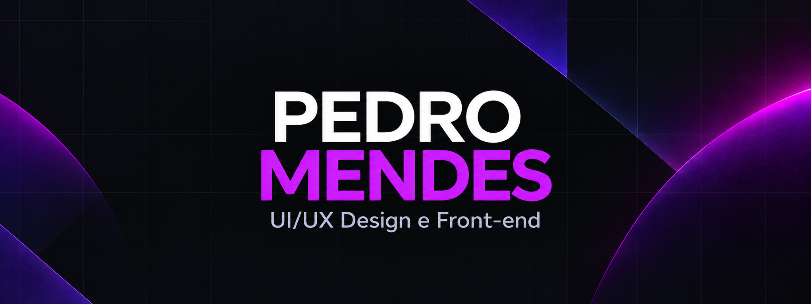
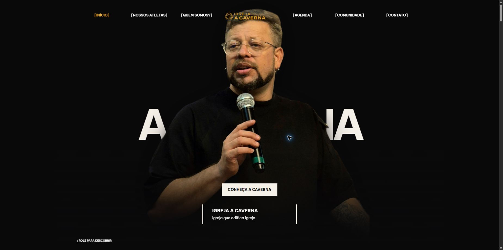
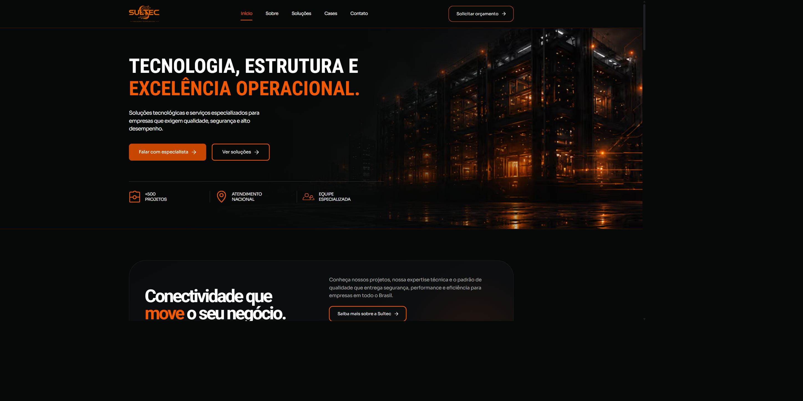
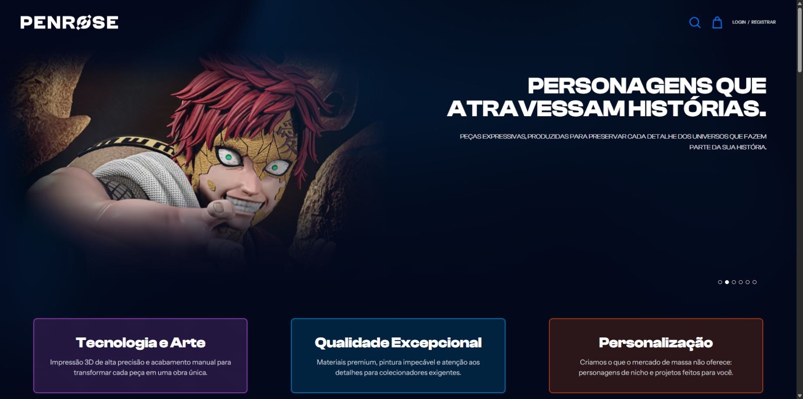

Transformo estratégia em marcas, interfaces e sites: da direção visual à implementação.

## Sobre mim

Sou designer e desenvolvedor front-end. Trabalho com identidade visual, sites, páginas de conversão e interfaces, conectando decisões de design às necessidades das pessoas e aos objetivos de cada projeto.

Implemento experiências responsivas com HTML, CSS, JavaScript, TypeScript, React e Next.js. Uso Figma para a direção visual, Git para acompanhar a evolução do código e Vercel para publicação.

- **Design:** identidade visual, interfaces, layouts responsivos e sistemas visuais.
- **Desenvolvimento:** HTML, CSS, JavaScript, TypeScript, React, Next.js e Tailwind CSS.
- **Forma de trabalhar:** entender o problema, organizar o conteúdo, desenhar, implementar, testar e publicar.

## Projetos selecionados

### 1. A Caverna — projeto principal

Site institucional para uma comunidade de fé, implementado a partir do Figma com React, TypeScript e Vite. Navegação entre páginas, adaptação para celular e tablet, tratamento de imagens e páginas pré-renderizadas para mecanismos de busca.

[Ver projeto](https://pedro-mendes-portfolio.vercel.app/projetos/caverna) · [Acessar site](https://igrejaacaverna.com.br/) · [Ver código](https://github.com/Pmendes38/caverna-estudo-de-caso)

### 2. Sultec — site institucional e conversão

Identidade visual e site em Next.js para uma empresa de soluções tecnológicas. Páginas de serviços e projetos, conteúdo institucional, formulários e caminhos de contato.

[Ver projeto](https://pedro-mendes-portfolio.vercel.app/projetos/sultec) · [Acessar site](https://sultectecnologia.com.br/) · [Ver código](https://github.com/Pmendes38/sultec-estudo-de-caso)

### 3. Penrose — e-commerce conectado ao ERP

Catálogo, páginas de produtos, cadastro, carrinho, cupom, checkout e acompanhamento de pedidos. O painel administrativo conecta produtos, clientes, pagamentos e ordens de serviço a um quadro de produção.

**Tecnologias:** Next.js, TypeScript, NestJS e MongoDB.

[Ver projeto](https://pedro-mendes-portfolio.vercel.app/projetos/penrose) · [Acessar site](https://penrose.com.br/) · [Ver código da interface](https://github.com/Pmendes38/penrose-estudo-de-caso) · [Ver código da API](https://github.com/Pmendes38/penrose-api-estudo-de-caso)

## Oportunidades

Busco oportunidades em **desenvolvimento front-end, design de interfaces e criação de sites**, com espaço para unir visão estratégica, cuidado visual e implementação prática.

[Conheça meu portfólio](https://pedro-mendes-portfolio.vercel.app/) · [Converse comigo no LinkedIn](https://www.linkedin.com/in/pedromendessouza/) · [Envie um e-mail](mailto:pedrohmendesds@gmail.com)
